  

 

 

<h2 align="center">⌜ Know About Me ⌟</h2>

<table>
<tr>
<td width="65%" valign="top">

 

**Hey, I'm Sai.**

Computer Science Final Year student, building backend services, data pipelines and AI-powered tools. I like to build systems that impact and help in bringing about a change.

- 🎓 Final-year B.Tech, graduating July 2027
- 🎯 Looking for **Full stack/Backend, Data Engineering and GenAI** internships
- ⚙️ Building APIs, streaming pipelines and multi-agent systems
- 🧠 Working through DSA, system design and cloud fundamentals

</td>
<td width="35%" align="center" valign="middle">

</td>
</tr>
</table>

 

<h2 align="center">⌜ Top Projects ⌟ (built to solve real problems)</h2>

<table>
<tr>
<td align="right">

</td>
<td align="left">E-commerce analytics pipeline: streaming ingestion, data-quality gates, dbt, Dagster, churn model.</td>
</tr>
<tr>
<td align="right">

</td>
<td align="left">Multi-agent research system with planner, researcher, writer and critic agents on LangGraph.</td>
</tr>
<tr>
<td align="right">

</td>
<td align="left">AI recruitment platform: resume parsing, semantic matching, interview scorecards.</td>
</tr>
<tr>
<td align="right">

</td>
<td align="left">Ask questions about any GitHub repository: hybrid retrieval, citation-backed answers.</td>
</tr>
<tr>
<td align="right">

</td>
<td align="left">Spend management dashboard with KPI charts, approval workflows and an AI copilot over live data.</td>
</tr>
</table>

 

<h2 align="center">⌜ ⛧ Languages · Frameworks · Tools ⛧ ⌟</h2>

 

 

<h2 align="center">⌜ 📊 GitHub Stats ⌟</h2>

  

 

<h2 align="center">⌜ 🐍 Contribution Snake ⌟</h2>

 

<h2 align="center">⌜ Connect ⌟</h2>

 

---

